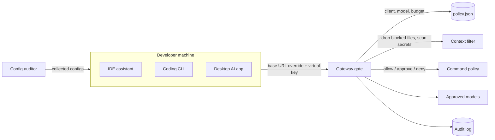

# Coding-Assistant Governance (lab)

**Recruiter summary.** Developers adopt IDE assistants, coding CLIs and desktop AI apps faster than security can review them, often with personal API keys that bypass every control. This lab defines one org policy (approved clients, gateway base URL, per-team models and budgets, blocked context files, command allow/approve/deny) and enforces it two ways: an **auditor** for developer-machine configs and a **gateway gate** that drops sensitive files, blocks secrets in context and rules on agent-proposed shell commands. All numbers come from a real run on a **synthetic** fleet and a self-written labelled snippet set.

<!-- BEGIN GENERATED -->

**Tests:** 55 passing (`python scripts/count_tests.py`).

**Results** (SYNTHETIC fleet and self-written labelled snippets (regression check, not a benchmark), 40 configs, 18 snippets, 12 commands):

| Metric | Value |
|---|---|
| Developer configs audited | 40 |
| Fully compliant configs | 26/40 (65%) |
| Violations by type | auto_approve_enabled=5, bypasses_gateway=3, personal_api_key=3, unapproved_client=2, unapproved_mcp_server=4 |
| Secret scanner precision | 8/9 |
| Secret scanner recall | 8/9 |
| Command policy decisions matching expected | 12/12 |
| Gate demo requests denied | 4/5 |
| Blocked files dropped from context | 1 |

<!-- END GENERATED -->

**Reading the numbers.** The fleet of 40 configs is synthetic (fictional *Quillstone Labs*) with violations injected at fixed rates. The secret set is small and self-written: a regression check with one known miss (low-entropy human password) and one known false positive (a secret's *name*), both kept as tests.

## Purpose and audience
Platform, security and developer-experience teams; engineers being trained to roll out coding assistants safely.

## Architecture


## How it works
1. `policies/policy.json` is the single source of truth, reviewed by PR.
2. `audit_config.audit` checks each machine's assistant config: approved client, gateway base URL, no personal key, approved MCP servers only, no auto-approve, team model, logging on.
3. `gate.Gate.request` denies unapproved clients, disallowed models and over-budget teams; drops files matching blocked globs (`.env`, `*.pem`, `*.tfstate`...) and denies if remaining files contain secrets.
4. `secrets.scan`: known key formats (cloud key ids, private keys, platform tokens, JWTs, connection-string passwords) plus an entropy check on secret-named assignments, skipping placeholders.
5. `gate.Gate.command`: deny (`rm -rf /`, `curl | sh`, force-push, `terraform apply`, `kubectl delete`), needs approval (`git push`, `pip install`, `npm publish`), else allow.

## Real code and output
```python
g.request("dev01", "platform", "ide-assistant", "code-large", {"src/app.py": "print(1)", ".env": "X=1"}, 1000)
# -> decision 'allow', files_dropped ['.env']
command_decision(P, "git push --force origin main")   # -> 'deny'
command_decision(P, "pip install requests")            # -> 'needs_approval'
```

## How to run
```bash
pip install -r requirements-dev.txt
python scripts/run_eval.py && python scripts/count_tests.py
```
Client routing examples: [deploy/client-settings.example.md](deploy/client-settings.example.md). Nothing here contacts a provider.

## Guardrails
Deny-by-default clients and MCP servers, gateway-only egress (personal keys flagged), blocked context globs, secret scanning before upload, command deny/approval lists, no auto-approve, audit log of every decision. gitleaks runs in CI with an allowlist limited to the fake fixtures.

## Limitations and known failures
- Low-entropy human passwords are missed; secret names can false-positive (both tested).
- Glob command matching is bypassable (aliases, scripts, `bash -c`); real enforcement needs a sandbox and OS-level controls.
- Config auditing assumes configs can be collected (MDM/endpoint agent); not implemented here.
- Budgets are in-memory.

## Built vs planned
| Item | Status |
|---|---|
| Policy, config auditor, gateway gate, secret scanner, command policy | Built + tested |
| Client routing examples | Written, not run |
| Endpoint collector, sandboxed command runner | Planned |

## Docs
[Implementation guide](docs/implementation-guide.md) · [Training](docs/training.md) · [Interview points](docs/interview-points.md) · [Threat model](docs/threat-model.md) · [ADRs](docs/adr/)

## Related repos
Jagadish-ai-gateway-control-plane (the gateway these clients route through), Jagadish-mcp-tool-usage-analytics, Jagadish-prompt-injection-evals.

MIT licensed. Lab code. All secrets in fixtures are fake.
